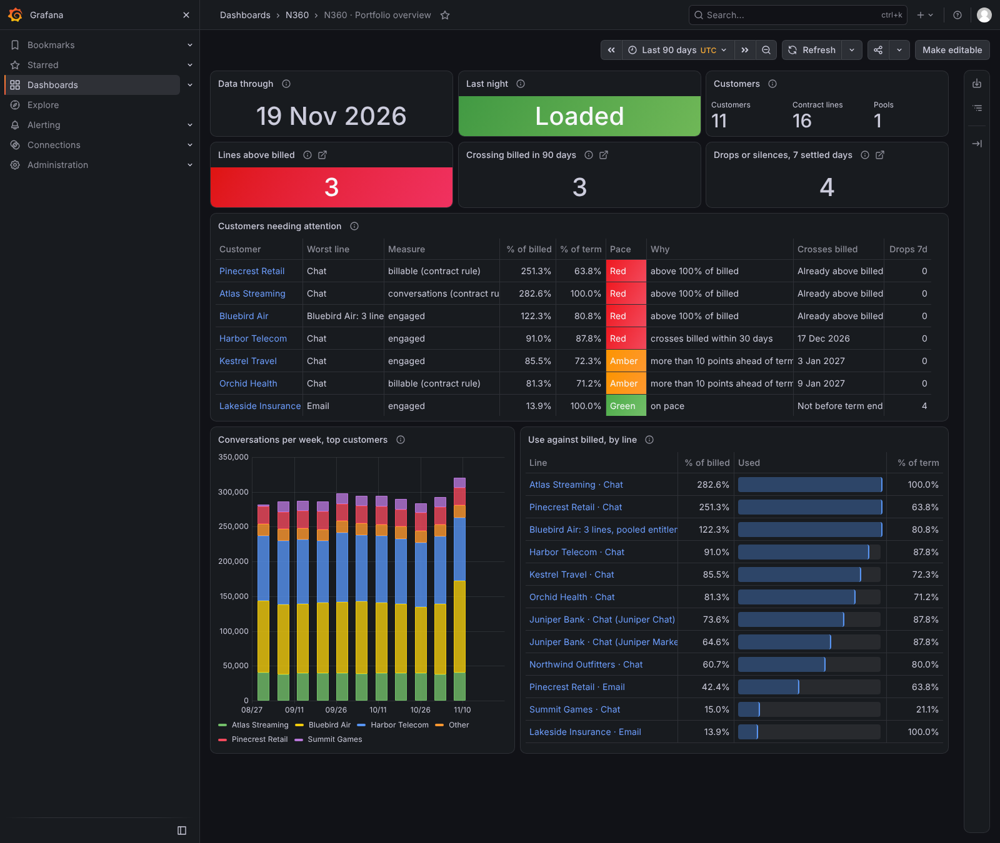

# N360

N360 shows, for every enterprise customer, how much of each signed contract is being used, how fast, when it will
run out, whether anything unusual is happening, and which customers are at risk.

It is **ClickHouse 25.8** for storage and **Grafana 13.3.1 OSS** for dashboards. Every dashboard is generated from
code. Everything in this repository runs on **synthetic data**; real data only ever lives on your own machine or
server.



## Try it in five minutes

No server needed. This generates synthetic data, checks it, loads it into an embedded database and builds the
dashboards:

```bash
pip install chdb==4.5.1 clickhouse-connect==1.13.0
```
```bash
python3 sample_data/generate_synthetic.py --out sample_data/rows
```
```bash
python3 code/load.py --rows sample_data/rows --chdb /tmp/n360
```
```bash
python3 code/grafana/build_dashboards.py
```

The load prints one `PASS` per data check, then `LOADED`.

To see the dashboards, start ClickHouse and Grafana with Docker:

```bash
cd code && cp .env.example .env
```

Set your own three passwords in `.env` (it is never committed), then:

```bash
docker compose up -d
```
```bash
set -a && . ./.env && set +a
python3 load.py --rows ../sample_data/rows --user n360 --password "$N360_CH_PASSWORD"
```

Open http://localhost:3000, sign in as `admin` with `GRAFANA_ADMIN_PASSWORD`, and open the **N360** folder.

## Where to go next

| You want to | Read |
|---|---|
| Run it on your Mac with real exports, every night | [docs/13_LAPTOP_POC.md](docs/13_LAPTOP_POC.md) |
| Check what data is missing before trusting the risk model | `python3 code/readiness.py` ([docs/13](docs/13_LAPTOP_POC.md) section 6) |
| Run it on AWS | [docs/12_AWS.md](docs/12_AWS.md) |
| Hand the project to another Claude | [docs/14_WORK_CLAUDE_HANDOFF.md](docs/14_WORK_CLAUDE_HANDOFF.md), then [docs/07_WORKING_RULES.md](docs/07_WORKING_RULES.md) |
| Know what a number means | [docs/03_METRICS.md](docs/03_METRICS.md) |
| Know what is decided and what is still open | [docs/08_DECISIONS.md](docs/08_DECISIONS.md) |

## The dashboards

All 14 are in the Grafana folder **N360**. Screenshots on synthetic data are in
[docs/screenshots](docs/screenshots).

| Dashboard | What it answers |
|---|---|
| **Overview** | What needs attention today, across every customer |
| **Contracts** | The status of every contract line: on track, behind, running out, renewal at risk |
| **Contract line** | One line: use against the term, forecast, the VAs behind it |
| **Customer** | One customer: contracts, usage, notes |
| **Customer health** | Which customers' usage or containment is moving the wrong way |
| **VA** | One virtual agent: conversations, containment, configuration |
| **Forecast and runway** | When each line runs out, and how accurate past forecasts were |
| **Anomalies** | Drops, spikes and silences, with a review log |
| **Containment** | Containment by customer and VA |
| **Adoption** | Which product features each customer uses (proposed design) |
| **Requests** | Open support tickets (proposed design) |
| **Risk** | Twelve risk signals per customer, for CSMs and customer architects |
| **Risk model** | Health score, chance of churn or downsell at renewal, and why |
| **Pipeline health** | Every night's load: loaded or refused, and how fresh each source is |

Panel-by-panel detail is in [docs/04_DASHBOARDS.md](docs/04_DASHBOARDS.md).

## How it works

1. **A nightly export** writes one folder of row files. At the company, a pipeline outside this repository does
   this. Here, `sample_data/generate_synthetic.py` stands in for it.
2. **`code/load.py`** stages the rows, runs the checks in `code/checks.sql`, and swaps the new data in only if every
   check passes. A bad night is refused and yesterday's data stays.
3. **`code/schema.sql`** holds every table, view and setting. Thresholds are settings, not code.
4. **`code/grafana/build_dashboards.py`** generates every dashboard. Never edit the JSON by hand; change the
   generator and run it again.
5. **Optional extras** run after the load: the Salesforce reader, the risk signals and the risk model.

More in [docs/01_ARCHITECTURE.md](docs/01_ARCHITECTURE.md).

## What is in the repository

| Path | What |
|---|---|
| `code/schema.sql`, `code/checks.sql`, `code/load.py` | Tables, views and settings; the pre-load checks; the loader |
| `code/grafana/` | Dashboard and alert generators, the generated JSON, Grafana provisioning, their tests |
| `code/risk/`, `code/risk_register.py` | The customer risk model; the CSM risk register and rating |
| `code/salesforce/` | Read-only Salesforce reader, with a fake Salesforce for tests |
| `code/forecast/`, `code/review_anomaly.py` | Challenger forecast backtest; anomaly review log |
| `code/ops/` | Nightly load, backup, restore, tunnel |
| `code/docker-compose.yml`, `code/clickhouse/`, `code/init/` | The local stack, its memory limits and the read-only Grafana user |
| `code/docker-compose.prod.yml`, `infra/aws/` | The production layer and Terraform for AWS |
| `chat/` | Asking questions of the data through Grafana's MCP server |
| `sample_data/` | Synthetic data generators: nightly rows, Salesforce records, a risk history with a known truth |
| `docs/` | Everything below |

## Tests

One command runs everything on synthetic data: 14 nights (one broken on purpose), every view, every dashboard
panel query, the alert rules, the Salesforce reader and the risk model.

```bash
code/ci.sh chdb
```

`code/ci.sh server` runs the same against a ClickHouse server. GitHub Actions runs both on every push
(`.github/workflows/ci.yml`).

## Status

Tested on synthetic data only unless a line says otherwise.

| Area | State |
|---|---|
| Schema, loader, checks, 14 dashboards | Built and tested. Running on a Mac with real exports. |
| Anomaly detection, forecast, forecast accuracy | Built and tested. Some thresholds are proposed ([docs/05](docs/05_ANOMALY_AND_FORECAST.md)). |
| Alerts | Built and tested, switched off ([docs/11](docs/11_ALERTS.md)). |
| AWS | Built and tested against a mock. Not yet run in a real AWS account. |
| Salesforce reader | Built and tested against a fake Salesforce. Not yet connected to a live org ([docs/19](docs/19_SALESFORCE_LIVE.md)). |
| Risk signals and register | Built and tested. Signal thresholds are proposed. |
| Risk model | Built and tested. Health and bands are usable. The chance at renewal is an expert estimate until real outcomes exist, and a review has open findings ([docs/21](docs/21_RISK_MODEL.md)). |
| Datadog, Langfuse | Planned only ([docs/20](docs/20_DATADOG_LANGFUSE.md)). |

## Rules

- **No real data in this repository, ever.** No customer names, numbers, hostnames, tickets or documents. Use the
  synthetic generators.
- **Never commit `.env`, tokens or passwords.**
- **Don't invent business facts.** A contract term, rule or threshold that isn't decided goes in as a setting marked
  *proposed*, with the open question in [docs/08_DECISIONS.md](docs/08_DECISIONS.md).
- **Keep table names, column names and dashboard uids unchanged.** The company pipeline writes these exact names.
- **Never edit dashboard JSON by hand.** Change `build_dashboards.py` and regenerate.
- **Versions are pinned.** Change one on purpose, not by accident.

The full working rules are in [docs/07_WORKING_RULES.md](docs/07_WORKING_RULES.md).

## All the docs

**Design**

| Doc | What it covers |
|---|---|
| [01 Architecture](docs/01_ARCHITECTURE.md) | The flow, the layers, why ClickHouse and Grafana, load and swap |
| [02 Data contract](docs/02_DATA_CONTRACT.md) | Every table and column, keys, NULL rules, the checks |
| [03 Metrics](docs/03_METRICS.md) | Every metric: definition, formula, grain, the words allowed on screen |
| [04 Dashboards](docs/04_DASHBOARDS.md) | Every dashboard, panel by panel, with drill-downs |
| [05 Anomaly and forecast](docs/05_ANOMALY_AND_FORECAST.md) | Methods and thresholds |
| [16 Dashboard review](docs/16_DASHBOARD_GAPS.md) | The v2 page structure, contract statuses and colours |

**Running it**

| Doc | What it covers |
|---|---|
| [13 Laptop](docs/13_LAPTOP_POC.md) | Set up on a Mac, load every night, look; get the risk model running on real data |
| [12 AWS](docs/12_AWS.md) | Create, load, Google sign-in, backups, upgrades |
| [11 Alerts](docs/11_ALERTS.md) | Switching alerts on, recipients, timing |
| [09 Chat](docs/09_CHAT.md) | Asking questions of the data through Grafana's MCP server |

**Risk**

| Doc | What it covers |
|---|---|
| [17 Risk research](docs/17_RISK_RESEARCH.md) | Market research, the twelve signals, what is built |
| [21 Risk model](docs/21_RISK_MODEL.md) | Features, scorecard, probability, how to run, test and change it |
| [22 Risk model backtest](docs/22_RISK_MODEL_BACKTEST.md) | The backtest on a synthetic history with a known truth |
| [23 Risk model review brief](docs/23_RISK_MODEL_REVIEW_BRIEF.md) | For an independent reviewer |

**Connections**

| Doc | What it covers |
|---|---|
| [18 Salesforce](docs/18_SALESFORCE.md) | What is read, credentials, running the reader |
| [19 Salesforce, live](docs/19_SALESFORCE_LIVE.md) | Connecting a live org: the nightly reader and Claude questions |
| [20 Datadog and Langfuse](docs/20_DATADOG_LANGFUSE.md) | The plan for both in Grafana OSS |
| [24 Adoption export](docs/24_ADOPTION_EXPORT.md) | The five files the company export must add for adoption and support data |

**Project**

| Doc | What it covers |
|---|---|
| [06 Backlog](docs/06_BACKLOG.md) | What to build next, with acceptance criteria |
| [07 Working rules](docs/07_WORKING_RULES.md) | How work is done here |
| [08 Decisions](docs/08_DECISIONS.md) | Decided, proposed and open |
| [10 Challenger backtest](docs/10_CHALLENGER_BACKTEST.md) | The challenger forecast against the straight line |
| [14 Handoff](docs/14_WORK_CLAUDE_HANDOFF.md) | Bringing another Claude up to speed |
| [15 Dashboard review brief](docs/15_DASHBOARD_REVIEW_HANDOFF.md) | The brief behind the v2 dashboards |
| [CHANGES.md](CHANGES.md) | What changed, newest first |
